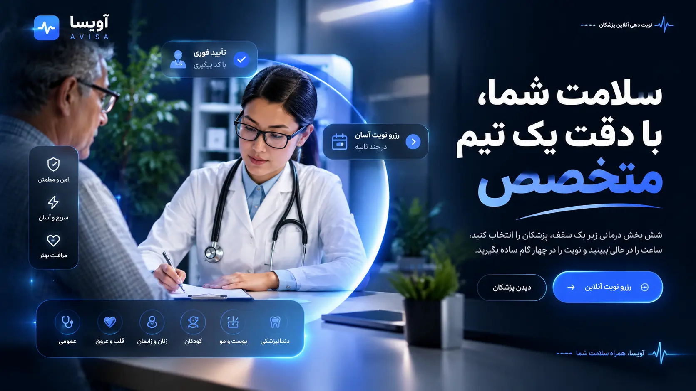

<div align="center">


<br>


</div>

<br>


<br>

<p align="center">
  
</p>

<p align="center">
A full front-to-back clinic website: a six-department landing page, a live multi-step appointment wizard with a running ticket card, and a streaming AI assistant proxied securely through a PHP backend. Built from scratch — no site builder, no template.
</p>

<br>


<br>

### ✨ Overview

Avisa Clinic is a single-page clinic website for a six-department medical practice in Tehran. It's built as a real product, not a mockup: every interaction — picking a department, scrolling the patient journey, booking a slot, talking to the assistant — is backed by actual state, actual validation, and a server-side API that keeps secrets off the client.

<br>

### 🧭 Features

- **Six-department showcase** — each department carries its own accent color, icon, and description, reused consistently across the booking flow and the doctor roster
- **Doctor carousel** — a horizontally scrollable, keyboard-accessible track of specialists linked to their department
- **Animated patient journey** — a scroll-driven four-step timeline (book → get a tracking code → visit → see the doctor) with a progress rail
- **Multi-step booking wizard** — department → doctor → date & time → contact details → confirmation, with:
  - a live **ticket card** that fills in as the patient progresses through each step
  - a **capacity bar** under each calendar day showing how full it is
  - a **generated tracking code and QR code** on confirmation
  - **Add to calendar (.ics)** and **copy code** actions
- **Live open/closed status** — reads the clinic's weekly hours and shows "open" / "closed" in real time, computed client-side from the visitor's clock
- **Testimonials carousel**, **FAQ accordion**, and a **contact form** with a stylized location card
- **Streaming AI assistant** — a chat widget answering patient questions (hours, departments, booking, insurance) over Server-Sent Events, so replies appear token-by-token instead of all at once
- Fully **responsive**, **RTL-first** (Persian), with a sticky mobile action bar and a slide-in mobile menu

<br>


<br>

### 🛠️ Tech Stack

<p align="center">


</p>

No frameworks, no build step. The entire front end is one semantic `index.html`, one design-token-driven stylesheet, and one dependency-free JavaScript file that renders every dynamic section (departments, doctors, calendar, reviews, FAQ) from a single config object at the top of the file — edit the data, the UI updates itself.

<br>

### 🔐 How the AI assistant stays secure

The chat widget never talks to the AI provider directly. Every message goes through `api/chat.php`, which:

| Safeguard | What it does |
|---|---|
| **Server-side keys** | API keys live in environment variables, never shipped to the browser |
| **Key rotation** | Rotates across multiple keys automatically if one fails or is rate-limited |
| **Origin check** | Rejects requests whose `Origin`/`Referer` isn't an allowed host |
| **Rate limiting** | Per-IP request caps, enforced server-side, independent of the client |
| **Input validation** | Caps message count and length before anything reaches the upstream API |
| **True streaming** | Proxies the provider's SSE stream chunk-by-chunk instead of buffering |

<br>


<br>

### 📂 Project Structure

```
avisa-clinic/
├── index.html              # Single-page markup (semantic, RTL, SEO meta)
├── assets/
│   ├── css/style.css        # Design tokens + full responsive styling
│   └── js/app.js            # All data (departments, doctors, FAQ, reviews)
│                             # + booking wizard logic + chat widget
├── api/
│   ├── config.php           # Server config (reads keys from env vars)
│   ├── chat.php              # Secure streaming proxy to the AI provider
│   └── .htaccess             # Blocks direct access to sensitive files
├── images/                  # Department photography + preview
└── .htaccess
```

<br>

### 🚀 Getting Started

**Static preview (no backend):**

```bash
# just open it
open index.html
```

Everything works except the AI assistant — the UI, booking wizard, calendar, and all content are fully client-side.

**With the AI assistant (PHP backend):**

```bash
php -S localhost:8000
```

Then set the following environment variables on your server before deploying (never commit real keys):

```bash
GROQ_KEY_1=your_key_here
GROQ_KEY_2=your_key_here   # optional, for automatic failover
GROQ_KEY_3=your_key_here   # optional
```

And add your domain to `allowed_hosts` in `api/config.php` so the origin check accepts it.

<br>


<br>

### 🎨 Design System

| Token | Value | Role |
|---|---|---|
| `--ink` | `#0C2340` | Primary text, dark surfaces |
| `--blue` | `#1F4FE0` | Primary accent, CTAs |
| `--amber` | `#FFB547` | Secondary accent, progress highlights |
| `--sky` | `#E9F0FF` | Light tinted backgrounds |
| `--ok` | `#12A36F` | Success / availability states |

Every color in the UI resolves to one of these tokens — change a value once, the whole site re-themes.

<br>

<div align="center">
<sub>Built by <b>Mohammadreza</b> — questions or feedback are always welcome.</sub>
</div>

<br>


